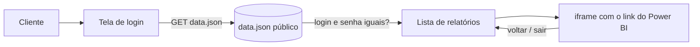

# Portal de Relatórios (`report_portal`) — Documentação técnica e funcional

> Repositório: `Cia-Talentos-DataHub/report_portal` (**público**, 1 commit, GitHub Pages em `https://cia-talentos-datahub.github.io/report_portal/`). Página estática (HTML + CSS + JavaScript puro, 2 arquivos) que dá a cada **cliente da Cia de Talentos** um login e uma lista de **relatórios Power BI** publicados na web, exibidos em `iframe`. Escrito para que alguém que nunca viu o sistema entenda o negócio e consiga **recriá-lo do zero**.

## 1. O que é e para quem serve
**Problema de negócio.** Os clientes dos programas de seleção precisam acompanhar relatórios (Power BI) sem ter conta Microsoft. O portal oferece uma tela de login da marca CT e entrega os relatórios de cada cliente.

| Perfil | Uso |
|---|---|
| Cliente | Entra com login e senha, vê seus relatórios e abre cada um dentro do portal. |
| Time de Dados | Cadastra clientes e links editando o `data.json` e publicando. |

## 2. Glossário
| Termo | Significado |
|---|---|
| **Usuário/cliente** | Item de `data.json` com `cliente`, `login`, `senha`, `relatorios`. |
| **Relatório** | `{nome, link}`; o link é de **publicação na web** do Power BI (`app.powerbi.com/view?r=...`). |

## 3. Fluxo


## 4. Arquitetura, stack e arquivos
`index.html` (≈ 21 KB: CSS com identidade laranja CT, três telas — login, lista e visualizador — e o JavaScript) e `data.json` (979 bytes, 2 usuários de teste). Sem backend, sem build, sem dependências. Hospedagem: GitHub Pages.

## 5. Variáveis de ambiente
Nenhuma.

## 6. Dados — estrutura de `data.json`
```json
{ "users": [ { "cliente": "Nome", "login": "usuario", "senha": "<texto claro>", "relatorios": [ { "nome": "Programa X", "link": "https://app.powerbi.com/view?r=<token>" } ] } ] }
```

## 7. Autenticação
O navegador baixa **todo o `data.json`** e compara `login` e `senha` digitados com os registros (`u.login === login && u.senha === senha`). **Não há autenticação real**: qualquer pessoa pode abrir `data.json` e ver todos os logins, senhas e links.

## 8. Interfaces
Três telas na mesma página: `#screen-login`, `#screen-reports` (cartões de relatórios, texto "Você tem N relatório(s) disponível(is)") e `#screen-viewer` (iframe com indicador de carregamento). Funções: `doLogin`, `showReports`, `openReport`, `goBackToReports`, `doLogout`, `escapeHtml`.

## 9. Regras de negócio
1. Login por igualdade exata de usuário e senha; erro mostra mensagem e limpa a senha.
2. O cliente só vê os relatórios do seu registro; cada um abre em `iframe`; "Voltar" limpa o `iframe`.
3. `data.json` é lido com `?v=<timestamp>` para evitar cache.
4. Nomes de relatório passam por `escapeHtml`.

## 10. Roteiro para recriar e checklist
1. Publicar os relatórios no Power BI (ou, melhor, incorporá-los com autenticação).
2. Criar `data.json` e `index.html` com as três telas.
3. Habilitar GitHub Pages.
4. Para uso real, **substituir o login por autenticação no servidor** (ver §12).

**Checklist**: [ ] autenticação real · [ ] senhas com hash e fora do repositório · [ ] relatórios incorporados com segurança (não "publicar na web") · [ ] repositório privado.

## 11. Apêndices — código-fonte real (credenciais e tokens redigidos)
### 11.1 `data.json`
```json
{
  "users": [
    {
      "cliente": "Teste 1",
      "login": "<login>",
      "senha": "<REDIGIDA>",
      "relatorios": [
        {
          "nome": "Programa Modelo",
          "link": "https://app.powerbi.com/view?r=<TOKEN_REDIGIDO>"
        }
      ]
    },
    {
      "cliente": "Teste 2",
      "login": "<login>",
      "senha": "<REDIGIDA>",
      "relatorios": [
        {
          "nome": "Programa Estágio",
          "link": "https://app.powerbi.com/view?r=<TOKEN_REDIGIDO>"
        },
        {
          "nome": "Programa Trainee",
          "link": "https://app.powerbi.com/view?r=<TOKEN_REDIGIDO>"
        }
      ]
    }
  ]
}
```
### 11.2 JavaScript de `index.html` (login e exibição)
```javascript

    // ─── Estado da sessão ───────────────────────────────────────────────────
    let currentUser = null;
    let allUsers = [];

    // ─── Carrega dados do JSON ──────────────────────────────────────────────
    async function loadData() {
      try {
        const res = await fetch('data.json?v=' + Date.now());
        const data = await res.json();
        allUsers = data.users || [];
      } catch (e) {
        console.error('Erro ao carregar data.json:', e);
        allUsers = [];
      }
    }

    // ─── Login ──────────────────────────────────────────────────────────────
    async function doLogin() {
      const login = document.getElementById('input-login').value.trim();
      const senha = document.getElementById('input-senha').value;
      const errorEl = document.getElementById('login-error');

      if (!allUsers.length) await loadData();

      const user = allUsers.find(
        u => u.login === login && u.senha === senha
      );

      if (user) {
        currentUser = user;
        errorEl.style.display = 'none';
        showReports();
      } else {
        errorEl.style.display = 'block';
        document.getElementById('input-senha').value = '';
        document.getElementById('input-senha').focus();
      }
    }

    // ─── Enter no campo de senha faz login ──────────────────────────────────
    document.addEventListener('DOMContentLoaded', () => {
      document.getElementById('footer-year').textContent = new Date().getFullYear();
      loadData();

      document.getElementById('input-senha').addEventListener('keydown', e => {
        if (e.key === 'Enter') doLogin();
      });
      document.getElementById('input-login').addEventListener('keydown', e => {
        if (e.key === 'Enter') document.getElementById('input-senha').focus();
      });
    });

    // ─── Mostra tela de relatórios ──────────────────────────────────────────
    function showReports() {
      document.getElementById('screen-login').style.display = 'none';
      document.getElementById('screen-viewer').style.display = 'none';

      const screenReports = document.getElementById('screen-reports');
      screenReports.style.display = 'flex';

      document.getElementById('header-client').textContent = currentUser.cliente;
      document.getElementById('reports-subtitle').textContent =
        currentUser.relatorios.length === 1
          ? 'Você tem 1 relatório disponível'
          : `Você tem ${currentUser.relatorios.length} relatórios disponíveis`;

      const grid = document.getElementById('reports-grid');
      grid.innerHTML = '';

      currentUser.relatorios.forEach((rel, idx) => {
        const card = document.createElement('div');
        card.className = 'report-card';
        card.setAttribute('role', 'button');
        card.setAttribute('tabindex', '0');
        card.innerHTML = `
          <div class="report-card-icon">
            <svg viewBox="0 0 24 24" xmlns="http://www.w3.org/2000/svg">
              <path d="M19 3H5c-1.1 0-2 .9-2 2v14c0 1.1.9 2 2 2h14c1.1 0 2-.9 2-2V5c0-1.1-.9-2-2-2zm-7 3c1.93 0 3.5 1.57 3.5 3.5S13.93 13 12 13s-3.5-1.57-3.5-3.5S10.07 6 12 6zm7 13H5v-.23c0-.62.28-1.2.76-1.58C7.47 15.82 9.64 15 12 15s4.53.82 6.24 2.19c.48.38.76.97.76 1.58V19z"/>
            </svg>
          </div>
          <div class="report-card-name">${escapeHtml(rel.nome)}</div>
          <div class="report-card-cta">
            Abrir relatório
            <svg viewBox="0 0 24 24"><path d="M8.59 16.59L13.17 12 8.59 7.41 10 6l6 6-6 6z"/></svg>
          </div>
        `;
        card.addEventListener('click', () => openReport(rel));
        card.addEventListener('keydown', e => {
          if (e.key === 'Enter' || e.key === ' ') openReport(rel);
        });
        grid.appendChild(card);
      });
    }

    // ─── Abre relatório no iframe ───────────────────────────────────────────
    function openReport(rel) {
      document.getElementById('screen-reports').style.display = 'none';
      document.getElementById('screen-login').style.display = 'none';

      const screenViewer = document.getElementById('screen-viewer');
      screenViewer.style.display = 'flex';

      document.getElementById('viewer-report-name').textContent = rel.nome;
      document.getElementById('viewer-loading').classList.remove('hidden');

      const iframe = document.getElementById('report-iframe');
      iframe.src = '';
      iframe.onload = () => {
        document.getElementById('viewer-loading').classList.add('hidden');
      };
      iframe.src = rel.link;
    }

    // ─── Volta para lista de relatórios ────────────────────────────────────
    function goBackToReports() {
      const iframe = document.getElementById('report-iframe');
      iframe.src = '';
      showReports();
    }

    // ─── Logout ─────────────────────────────────────────────────────────────
    function doLogout() {
      currentUser = null;
      document.getElementById('input-login').value = '';
      document.getElementById('input-senha').value = '';
      document.getElementById('login-error').style.display = 'none';
      document.getElementById('screen-reports').style.display = 'none';
      document.getElementById('screen-viewer').sty
```

## 12. Pontos de atenção
| # | Achado | Impacto / recomendação |
|---|---|---|
| 1 | **Login falso**: logins e senhas em texto claro num arquivo público; qualquer um as vê em `/data.json` | Não protege nada. Os dados atuais são de teste ("Teste 1/2"), mas o desenho não pode ser usado com clientes reais. |
| 2 | Os links são de **"Publicar na web" do Power BI**: qualquer pessoa com o link vê o relatório, sem autenticação, e o link está no `data.json` público | Dados de clientes expostos na internet. Usar Power BI incorporado com identidade (embed token) ou Entra ID B2B. |
| 3 | O parâmetro `r=` do link é um JSON em Base64 com o identificador do relatório e o tenant da CT | Divulga identificadores internos. |
| 4 | Sem limite de tentativas, sem registro de acesso, sem sessão | Força bruta e ausência de auditoria. |
| 5 | Cadastro de clientes por edição manual do JSON | Erro humano e sem governança; usar um cadastro com perfis. |
| 6 | Repositório e site públicos | Se evoluir para uso real, mover para repositório privado e hospedagem autenticada. |
